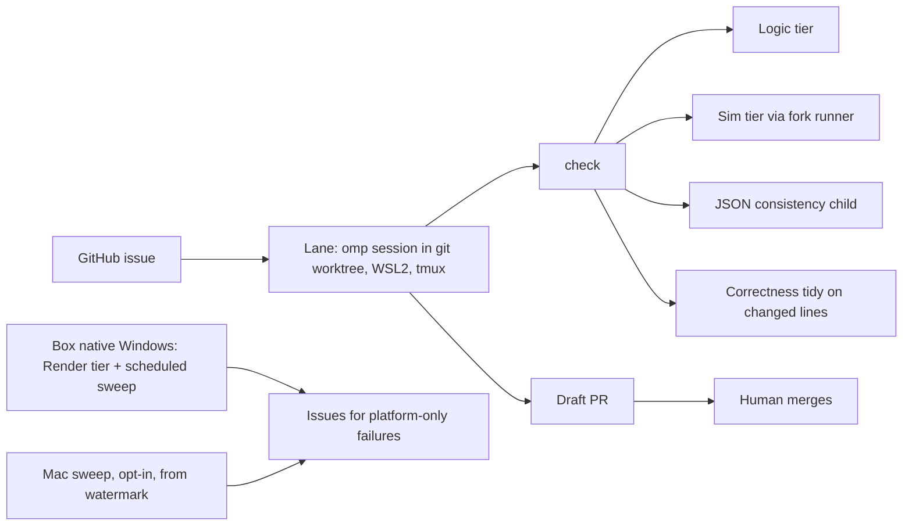

# Agentic test re-approach

Status: agreed in a grilling session 2026-10-13; nothing implemented. Decisions recorded in ADR-0004, ADR-0005, ADR-0006 and the Verification section of `GLOSSARY.md`.

Supersedes, decision by decision (each superseded plan gets a header note pointing here in Phase 2, and moves out of the tree when its last live decision is gone):

| Plan                                    | Superseded                                                                                                                                                                                                   | Still live                                                                                                                                                                                  |
| --------------------------------------- | ------------------------------------------------------------------------------------------------------------------------------------------------------------------------------------------------------------ | ------------------------------------------------------------------------------------------------------------------------------------------------------------------------------------------- |
| `plans/dev-loop-speed-and-stability.md` | The LOCKED macOS fast-preset target (leaf <= 20 s, #135) and the macOS-first framing; the Mac fast preset is no longer built. **Fast preset** is redefined in GLOSSARY as the WSL executor's non-LTO preset. | Its Mac leaf/hub measurements (the baseline Phase 0 replaces), the ccache/PCH sloppiness findings, the cross-root PCH impossibility (#140) and the unused-include pruning rejection (#153). |
| `plans/agent-playtest-pipeline.md`      | Oracles, daemon, fixture baseline, mock driver, windowed capture (Phase 5).                                                                                                                                  | The driver protocol and the thin start/step/stop CLI.                                                                                                                                       |
| `plans/agentic-software-factory.md`     | Factory, labels, herdr lanes, 10-step gate, baseline ratchet (Phase 2).                                                                                                                                      | GitHub issues as the queue; protected-path guard; human merges.                                                                                                                             |

## Why

Measured 2026-10-12/13, not estimated.

| Symptom                                               | Evidence                                                                                                                                                                                                                                                                                       |
| ----------------------------------------------------- | ---------------------------------------------------------------------------------------------------------------------------------------------------------------------------------------------------------------------------------------------------------------------------------------------- |
| 11 s fixed tax per test process                       | `--list-tests` 0.12 s; no-match filter 11.7 s; 3-case `[calendar]` 13.3 s, 8 ms of it in tests (`tests/test_main.cpp:451`, TODO at :450)                                                                                                                                                       |
| Gate is 10 steps, 12 to 15 min, one unsharded process | `tools/factory/gate.ts:97-429`, ratchet `:327-352`                                                                                                                                                                                                                                             |
| Whole suite truncated by one crash                    | `tests/driver_loop_test.cpp:535` SIGSEGV in isolation, observed on the Oct 9 test binary; `git log --since=2026-10-09` shows no change to `src/driver_loop.cpp`, `src/driver_items.cpp`, `tests/driver_loop_test.cpp` or `src/thread_pool.h` since, but re-confirm on a fresh build in Phase 0 |
| Order-dependent cases                                 | `vision_test.cpp:253` failed 1 to 9 times by partition                                                                                                                                                                                                                                         |
| Allow-lists as work items                             | 7 Windows / 13 macOS baseline failures (`config.json:36-62`); 8 of 11 blocked factory tickets are baseline/flaky meta-tickets                                                                                                                                                                  |
| Pipeline jammed                                       | `factory status`: 11 blocked, 2 ready, 0 in progress; 1 factory PR ever merged (#165)                                                                                                                                                                                                          |
| Lint noise blocks honest work                         | 8 wsl-lane failures (clang-tidy inside vendored `sol.hpp`, astyle on untouched code); 9 "no commit" dead-ends                                                                                                                                                                                  |
| Harness eats the effort                               | 137 of the last 300 commits are bnplay (76) + factory (61); 18 touch product `src/`/`data/`                                                                                                                                                                                                    |
| Hub headers                                           | `vehicle.h` ~350 s, `map.h` ~630 s on the Mac (`plans/dev-loop-speed-and-stability.md`)                                                                                                                                                                                                        |

## Settled decisions

| Topic               | Decision                                                                                                                                                                                                                                                                                                                                                                                                                                                                         |
| ------------------- | -------------------------------------------------------------------------------------------------------------------------------------------------------------------------------------------------------------------------------------------------------------------------------------------------------------------------------------------------------------------------------------------------------------------------------------------------------------------------------- |
| Inner-loop target   | Logic tier <= 5 s; Sim tier <= 30 s (affected subset)                                                                                                                                                                                                                                                                                                                                                                                                                            |
| Executor            | WSL2 Linux on the i9-14900K box, repo on ext4 inside WSL, `linux-slim` lineage (not `linux-full`: that preset pulls the tidy plugin and Tracy, `CMakePresets.json:100,108`), non-LTO fast preset = `linux-slim` with `CMAKE_INTERPROCEDURAL_OPTIMIZATION=OFF` (ADR-0005). The preset asks for unversioned `llvm-ar`/`llvm-ranlib`, which are NOT on PATH in WSL (only under `/usr/lib/llvm-22/bin`); pass them explicitly and record the compiler versions in every measurement. |
| Runner              | Fork runner on Linux, in-process runner on Windows and macOS (ADR-0004)                                                                                                                                                                                                                                                                                                                                                                                                          |
| Tiers               | Logic, Sim, Render (GLOSSARY: Verification)                                                                                                                                                                                                                                                                                                                                                                                                                                      |
| Render              | Catch2 Render tier on native Windows + 4090 (ADR-0006)                                                                                                                                                                                                                                                                                                                                                                                                                           |
| Determinism         | Headless driver path only; invariants asserted, not exact world state, elsewhere                                                                                                                                                                                                                                                                                                                                                                                                 |
| Platform parity     | Linux per change; Windows sweep scheduled on the box; macOS sweep opt-in with watermark, never blocking                                                                                                                                                                                                                                                                                                                                                                          |
| Mac                 | Owner's workstation and Metal check; not an executor                                                                                                                                                                                                                                                                                                                                                                                                                             |
| Failing/flaky tests | Quarantine with a dated expiry; no baseline allow-list                                                                                                                                                                                                                                                                                                                                                                                                                           |
| Style               | Auto-fixed, never a gate failure; single formatter clang-format (pinned PyPI wheel); one mass reformat                                                                                                                                                                                                                                                                                                                                                                           |
| Merge               | Human merges; every other human touchpoint removed; `needs-human` only for genuine ambiguity                                                                                                                                                                                                                                                                                                                                                                                     |
| Implementer model   | Keep haiku; stalls are treated as harness bugs                                                                                                                                                                                                                                                                                                                                                                                                                                   |
| Upstream            | Diverge: this fork is the product; it is the only maintainer's                                                                                                                                                                                                                                                                                                                                                                                                                   |
| Languages           | English only: i18n checks, pipelines, non-English docs deleted; the `_()` API is left untouched                                                                                                                                                                                                                                                                                                                                                                                  |
| Cleanup             | A skill, plan or script is deleted in the same change that removes what it works around                                                                                                                                                                                                                                                                                                                                                                                          |
| Monitoring          | SSH + attach to the lane; one append-only event log per lane; transcript; issue/PR comments                                                                                                                                                                                                                                                                                                                                                                                      |

Picked by me when delegated (confirm or override): the `check` command fails on compile, all tiers, JSON consistency, correctness-tidy on changed lines, protected-path guard. JSON format is auto-fixed. The new-test-present rule and the clean-tree rule are dropped.

## Target shape

`check` is one command with one exit code. Auto-fix runs first (clang-format, `clang-tidy --fix` for modernize and the point-API style checks, JSON formatter); it never fails the check.

## Test architecture

- **Logic tier**: 42 files / 233 cases (about 15% of 1541) need no world, language, options, static data or avatar (ScoutLogicTier). Membership is a manifest of filename tags (`--filenames-as-tags` is already injected at `build-scripts/run-linux-test-shards.ts:166-167`); `main()` computes the selected cases with `Catch::filterTests(getAllTestCasesSorted(cfg), cfg.testSpec(), cfg)` after `applyCommandLine` and skips `init_global_game_state` when every selected case is in the manifest (the TODO at `tests/test_main.cpp:450`). A listener asserts `g == nullptr` for Logic cases so a stray `g->` fails loudly.
- **Init cut** (Sim tier floor): measured phases of the 11.7 to 12.5 s: JSON load+finalize+check 6.6 to 7.3 s, `map::load`+avatar+weather 3.3 s, SDL/GPU 0.7 s. `check_consistency` (3.0 s, `init.cpp:1286-1366`, no skip flag exists) is validation-only: remove it from init and run it as one extra child alongside the cases so wall time does not grow. The stale `data/json/data.jsonpack` saves only 0.47 s even when valid (`init.cpp:419-521`); delete the pack, its writer `tools/pack_mod_json.ts` and the `try_load_pack` path rather than repairing them. Mapgen weights (0.9 s) cannot be made lazy (`init.cpp:1237-1240`) and `map::load` is structural. Expected floor about 8 s once per run.
- **Fork runner**: after init, the parent forks one child per selected case with an exact-name filter, a per-case timeout, its own `--user-dir`, and aggregates results (ADR-0004). Fork hazards found (ScoutInitCost): 7 pool workers vanish in the child and `parallel_for` blocks (`thread_pool.h:206`; `MULTITHREADING_ENABLED:false` verified to complete in 14.30 s on macOS); `mapbuffer::_subs_mutex`, `overmap_buffer::extras_mutex_`, `stream_cache` LRU (`init.cpp:556`) may be held across fork; sqlite `map.sqlite3` opened in the world ctor (`world.cpp:585-586`) must be reopened per child; the child must skip the `on_out_of_scope` teardown (`test_main.cpp:442`) and `clear_all_state`/`delete_world` (`:470-477`). Box2D and Lua are heap-only and safe.
- **Zygote GPU policy**: `init_test_sdl_gpu()` runs before the JSON/world load (`tests/test_main.cpp:248`) and a live SDL/Vulkan device or lavapipe workers do not survive `fork()`. The fork runner's zygote therefore runs with `CATA_TEST_COMPUTE_ACCELERATION=cpu` and `MULTITHREADING_ENABLED:false`; cases tagged `[gpu]` or `[render]` go to the in-process runner. The `lightmap.cpp:903` error ("SDL_GPU transparency is required") sits on the GPU path only; `test_main.cpp:137-151` already downgrades to the cpu lightmap path when no device exists, so a cpu zygote should avoid it. NOT yet proven: Phase 1 opens with a spike that loads the world with cpu accel, forks two children and runs one lighting-dependent case in each; ADR-0004 stays "pending spike" until it passes.
- **Quarantine**: `[.quarantine]` tag plus a dated entry; an expired entry opens a ticket. First Linux run establishes the real list (it is unmeasured today). `driver_loop_test.cpp:535` SIGSEGV and the 13/7 baseline entries enter it unless fixed first.
- **Render tier**: see ADR-0006 prerequisites. The two image functions are ported from `tools/bnplay/frames.ts:197-211` (mean-abs delta) and `compare.ts` (changed-pixel count, A/A noise mask, dilate 2, `MAX_CHANGED` 1500).
- **Render per change**: a lane whose diff touches render paths (`src/lighting/**`, `src/sdl_*`, `src/shaders/**`, `data/shaders/**`, `tests/*render*`) also builds `win-rel` natively and runs `cata_test-tiles.exe "[render]"` on the box through WSL interop (`/mnt/c/...exe`); other lanes get no pixel verdict until the Windows sweep. Phase 0 measures the incremental MSVC build cost; if it exceeds the Sim budget, the render check runs once per PR (before the human merge) instead of per iteration, and the plan says so.
- **Determinism (driver path)**: seed every RNG through `rng.h` on the headless path (the `cata-determinism` check stays); an A/A replay case guards it. Without this, bnplay SKILL.md:71 (same-seed Episodes diverge at the first world step) stands.
- **Hub headers**: do not refactor `map.h`/`vehicle.h` on spec. Measure on the box first (Phase 0); open a header-split ticket only if a hub edit exceeds the agreed budget there.

## Slimming inventory (each line deleted with its replacement)

| Remove                                                                                                                                                          | Size                                                              | Replaced by                                                                                                                                                                                                             |
| --------------------------------------------------------------------------------------------------------------------------------------------------------------- | ----------------------------------------------------------------- | ----------------------------------------------------------------------------------------------------------------------------------------------------------------------------------------------------------------------- |
| `tools/factory/**` (herdr lanes, labels, stamps, pre-push, 20 moving parts)                                                                                     | 6,561 LOC                                                         | `check` + git worktree + tmux lane                                                                                                                                                                                      |
| `gate.ts` 10 steps, `config.json` baselines, `ratchet.ts`                                                                                                       | part of the above                                                 | Quarantine                                                                                                                                                                                                              |
| `tools/bnplay` oracles, daemon, mock driver, fixture baseline, windowed capture, doctor, 16 mock test files                                                     | 13,538 LOC total, keep a thin start/step/stop CLI over the driver | Catch2 `[driver]` + Render tier                                                                                                                                                                                         |
| astyle 3.6.16, its CI build, `// *NOPAD*` workarounds                                                                                                           | autofix.yml:41-50                                                 | clang-format only                                                                                                                                                                                                       |
| `tools/clang-tidy-plugin` 13 of 16 checks, HeaderGuard/TextStyle dead files, 47 `NOLINT(cata-text-style)`                                                       | about half of 6,257 LOC                                           | keep `cata-determinism`, `cata-no-long`, `cata-test-filename`                                                                                                                                                           |
| 15 of 16 workflows (`factory-ci`, `clang-tidy`, `coop-e2e`, `autofix`, `matrix`, `build`, `release*`, `docs`, translation and PR-artifact bots)                 | 2,729 LOC                                                         | no CI: `deno task check` on the box is the gate, enforced by a pre-push hook; releases manual from local builds                                                                                                                               |
| Translation tooling, non-English docs (`docs/de`, `ja`, `ko`, `ru`), `docs_translation_warning`, i18n skills and `docs/agents/i18n.md`                          | n/a                                                               | English only                                                                                                                                                                                                            |
| ~51 workaround `cbn-*` skills in `~/.omp/agent/managed-skills` (outside the repo, so git history does NOT keep them); `plans/done/` (27,365 lines, in the repo) | n/a                                                               | each tool-removal change carries an explicit out-of-repo step listing the skill dirs it obsoletes; the owner runs it, and a dead skill is exported to a tarball first if recovery matters                               |
| `tools/devloop-*.ts` Mac measurement harness                                                                                                                    | 382 LOC                                                           | kept only if Phase 0 reuses it                                                                                                                                                                                          |
| `coop-e2e.yml`, `matrix.yml` `coop_tests`: 11 two-process scenarios (`scripts/test_coop.ts`), which cannot run inside a forked Catch2 child                     | n/a                                                               | `check` runs `deno task test:coop` when the diff touches `src/coop*` or `src/net*`; `[coop]` Catch2 cases stay in the normal tiers                                                                                      |
| `matrix.yml` `coop_tsan`, `coop_asan`: the only sanitizer coverage                                                                                              | n/a                                                               | a weekly TSan and ASan build on the box (WSL) running `[coop]`, reporting through the sweep issue path                                                                                                                  |
| `translations.h` (reaches 693 TUs by `ninja -t deps`): fan-out comes from what the header pulls in, not the number of `_()` call sites                          | n/a                                                               | Phase 3 option, taken only if Phase 0 shows it moves rebuild time: replace it with a tiny header where `_()`, `n_gettext`, `pgettext` are inline identity passthroughs and gettext is dropped; call sites are untouched |

Do not delete `docs/adr/`, `GLOSSARY.md`, the driver C++ (`src/driver_*`, 3,544 LOC) or `tests/driver_*`. Resolve the `AGENTS.md` conflicts with the new style policy in the same change (trailing-return, `// *NOPAD*`, "MUST satisfy cata-*").

## Phases

Each phase ends only with a measured result. No phase starts before its predecessor's numbers exist.

0. **Measure on the box** (blocked on OpenSSH access to the box). Start from the existing WSL lane: `tools/factory/wsl/setup.sh` (Ubuntu 24.04, LLVM 22, mold, ccache, ninja, mesa-vulkan, xvfb); check whether `$HOME/bn-tidy` exists and when it was last used. In WSL2 on ext4: cold `linux-full` build, leaf edit (`.cpp`, with and without ThinLTO), `vehicle.h` and `map.h` edits, init, full suite as it stands today, the incremental native `win-rel` build for a render-path edit, and `tailscale ping` for a direct path. Output: a table that replaces the Mac numbers. Acceptance: hub-header and leaf rebuild budgets agreed from real numbers; a fast non-LTO preset exists if the leaf edit exceeds the Sim budget; lane count chosen against the disk budget (144 GB free: each worktree build dir plus a 3.2 GB `lto.cache` plus the ccache cap adds up).
   Box state (2026-10-13, verified over `ssh cbn-box`): Windows OpenSSH with key auth (dedicated key), tailnet-only firewall rule; WSL2 Ubuntu 24.04, `nproc` 32, 47 GB RAM, `vmIdleTimeout=-1`, a detached tmux session survives an ssh disconnect; clang-22, mold, cmake, ninja, ccache (20 GB) installed; shadercross provisioned at `~/cbn/vcpkg-shadercross` (`~/cbn/env.sh`); `~/bn-tidy` never existed. Tailscale path is DERP (Frankfurt/Amsterdam, 39 to 76 ms), no direct connection. The measured tree is `~/cbn/src` at `origin/feature/improvements` (c4870f7b5d2e), NOT this Mac's HEAD (5dde3de548, ahead 4 / behind 12, plus another session's uncommitted factory work, which is left alone); the only files copied from the Mac are the untracked `data/shaders/lighting/src/emitter_glow.{vert,frag}.hlsl` (sha256 verified). The 19 gitignored `.msl` files are Metal-only and are not copied. Phase 0 records the exact SHA it measures. Constraint: the WSL virtual disk reports 1 TB but is backed by C:, which has about 123 GB free (the 80 GB Windows checkout and two large factory worktrees live there too), so lane count and build-dir retention are bounded by C:, not by what `df` shows in WSL. `~/.wslconfig` also carries a pre-existing `networkingMode=mirrored`; `sudo` in WSL needs a password, so any `apt` run is the owner's.
1. **Zygote spike, then fork runner + init cut + Logic tier + Quarantine** in `tests/test_main.cpp` (additive, new files for the runner). The spike (see Zygote GPU policy) gates the rest; if it fails, fall back to an in-process runner with the init cut, Logic tier and Quarantine only, and ADR-0004 is superseded. Acceptance: full `~[.]` suite on Linux in <= 60 s wall on the box [INFERENCE: 35 to 45 s]; Logic tier selection runs in <= 5 s; `driver_loop_test.cpp:535` no longer truncates a run; zero failures outside Quarantine on three consecutive runs with different `--rng-seed`.
2. **`check` + thin lane + pre-push hook; delete factory, gate, and all 16 workflows (no CI).** Acceptance: one issue goes from `ready` to a draft PR with no human touch and a passing `check` stamp on the box; **(2026-10-14: #198 is being implemented directly, so the lane acceptance moves to a different ready issue, chosen when the lane tools are installed)** a human can attach by ssh and read the event log mid-run.
3. **Style**: clang-format wheel pinned, one mass reformat commit (landed when no lane is in flight; the 8 unmerged `backup/factory/*` branches are written off), astyle removed, plugin cut to 3 checks, AGENTS.md updated. Acceptance: `check` never fails on formatting; a deliberate misformat is fixed by auto-fix.
4. **Render tier**: ADR-0006 prerequisites, then the first golden and one paired-run case. Acceptance: the same frame twice on the box differs by <= the noise mask; a deliberate lighting change fails.
5. **bnplay slimming**: thin CLI over the driver; oracles, daemon, mock, fixture baseline, windowed capture deleted. Acceptance: `deno task bnplay` start/step/stop still drives a boot-and-idle Episode; `tools/bnplay` is under about 2k LOC.
6. **Platform sweeps**: Windows scheduled on the box; macOS opt-in command with a watermark file; both open issues for platform-only failures. Acceptance: skipping a macOS sweep for three commits, then running it, covers all three and clears the watermark.
7. **Knowledge purge**: delete the workaround skills and archived plans whose tool is gone. Acceptance: no skill refers to a deleted command.

**Phase 0 results (2026-10-13, box, origin c4870f7b5d plus the patches in `~/cbn/phase0/`; Linux = `linux-slim`/`linux-fast`, 32 threads):**

| Measurement                                                   | Result                                                                 |
| ------------------------------------------------------------- | ---------------------------------------------------------------------- |
| Linux cold build, LTO on (cache off)                          | about 8 min (245 s + 232 s resume) plus 83 s configure incl. network   |
| Linux cold build, LTO off                                     | 405 s                                                                  |
| Leaf edit, LTO off / on                                       | 2.0 s / 9.7 s (Mac: 22 s)                                              |
| `vehicle.h` edit, LTO off / on                                | 119 s / 107 s (Mac: 351 s)                                             |
| `map.h` edit, LTO off / on                                    | 237 s / 211 s (Mac: 632 s)                                             |
| No-PCH lane preset (cache off): leaf / `vehicle.h` / `map.h`  | 3.4 s / 134 s / 268 s (+12 to 14% over PCH)                            |
| New lane: seeded configure + build on shared ccache (PCH off) | 50 s + 4 s (99.96% hits)                                               |
| Test init (Linux, pool on)                                    | 7.3 to 8.2 s (Mac: 11.7 s)                                             |
| Full `~[.]` suite, 4 shards, after atomic fix                 | 198 s wall; 1452 pass, 7 fail, no crash (before the fix: shard 3 hung) |
| Init-only crash rate, pool on                                 | 10/20 before the fix, 0/20 after; pool off 0/20                        |
| Windows leaf / wide-header content edit                       | 26 s / 54 s                                                            |
| Windows `[render]` run                                        | crashed `0xC0000005` after 19 s (uninvestigated)                       |

Phase 0 acceptance: budgets for hub edits (about 2 to 4.5 min on Linux with LTO off) are far above the seconds target, so header splits for `map.h`/`vehicle.h` stay an open ticket; leaf edits meet the budget; lane count is bound by CPU (about 3 GB disk per lane), not disk.

**Phase 1 zygote spike results (2026-10-13, box, `~/cbn/phase0/zygote-spike.patch` on `tests/test_main.cpp`, behind `CATA_ZYGOTE_CASES`/`CATA_ZYGOTE_JOBS`, CPU compute, pool off):**

- **Fork works.** Sequential, then parallel children from one initialised parent; 1437 of 1459 cases (22 dropped because their names contain Catch2 filter characters; they need a different selector). No sqlite or lock lines in any child log, no hangs, at 16 and 32 children at a time.
- **Wall time.** Full suite 133.7 s at 16 wide, 114.6 s at 32 wide, 109.9 s at 32 wide with `DISPLAY` unset, against 198 s for the default 4-shard in-process run and 184.8 s for the in-process CPU run. The Phase 1 acceptance line's "[INFERENCE: 35 to 45 s]" is WRONG: the measured floor is about 110 s, and its cause is not yet measured (candidates: serial `fork()` of a 1.7 GB parent, long-pole cases of 15 to 19 s, core and memory contention).
- **Parent exit crash is the X connection.** With `DISPLAY=:0` and `WAYLAND_DISPLAY=wayland-0` set (WSLg), SDL uses a real window system, `use_offscreen_video_driver_for_headless_sdl()` is skipped, the forked children share one X socket, and the parent core-dumps at exit (`X connection to :0 broken`, rc 139). With both unset the parent exits normally. Every Linux test run and lane must unset `DISPLAY`, `WAYLAND_DISPLAY` and `SDL_VIDEODRIVER` (or the runner must force the offscreen driver).
- **Routing list (CPU compute vs default).** The Linux default is NOT the CPU path: Mesa lavapipe is installed, so the default selects `vulkan software-required`, and the earlier Linux baseline was a lavapipe-GPU-path baseline. In-process CPU compute, pool off: 11 failures, all 4 `vision_*` cases (`vision_see_into_vehicle`, `vision_see_out_of_vehicle`, `vision_single_tile_skylight`, `vision_wall_obstructs_light`) fail only on the CPU path (they are also on the macOS baseline, where no GPU device exists), so these 4 need the GPU path and go to the in-process runner.
- **Isolation helps (6 cases).** `box2d_terrain_colliders_build_and_rebuild`, `fixed window activity skip honors wait duration at low action scale`, `grabbed_shopping_cart_can_be_pulled_down_ramp`, `place_player_can_safely_move_multiple_submaps`, `pulling_away_with_cruise_accelerates` and `the rebuild plan lists the levels the dirty state licenses for rebuild` fail in-process (default and CPU) and pass when each runs in a fresh child: they are state leaks between cases, not real defects. Only `MSX++UnDeadPeopleEdition cross-sheet tile sprites are anchored to their sheet` is a real failure in every mode.
- **Fail only when forked (3 cases, open).** `driver_loop_attach_view_adds_the_view_to_every_observation` and `driver_loop_attached_view_keeps_the_response_within_the_ceiling_and_says_when_it_cut` die with SIGSEGV in the child even with `DISPLAY` unset (no stack trace in the child log; cause unknown); `vehicle_ramp_test_60` fails (4 failures) only in a child, so it depends on state an earlier case leaves. `the rebuild plan lists the levels…` also failed at 16 wide and at 32 wide with `DISPLAY` unset but not at 32 wide with it set, so it is flaky when forked.
- **Lightmap cost and the GPU question.** On the heaviest case (102 cache builds), per call: default lavapipe 67 ms, CPU with pool on 37 ms, CPU with pool off 57 ms (idle box). So lavapipe is slower than the CPU path, and pool-off costs about 1.5x, not 6x. The 5,682 child cache builds summed to 1,231 s at 217 ms each, but that figure is inflated by 32 children contending (about 4x the solo cost) and is not a lightmap total: at 57 ms the same calls would be about 320 s if the heavy case is representative (unverified). Component split under contention: `seen` 419 s, `lightmap` 395 s, `floor` 167 s, `trans` 124 s, `outside` 76 s. 1264 of 1268 regeneration lines cover all 21 z-levels; whether levels other than z=0 dominate the cost is NOT measured (needs per-level timing). No real GPU is reachable from WSL (only lavapipe and other Mesa ICDs; `/dev/dxg` present, no NVIDIA or D3D12-translation Vulkan driver installed). GPU offload is not worth pursuing before restricting regenerated levels and fixing the pool-off cost.
- **Verdict on the spike gate.** A CPU, pool-off zygote forks cleanly and runs lighting-dependent cases in parallel children: ADR-0004 stands, with the routing list, the `DISPLAY` rule and the 3 fork-only failures as open work for the runner.
- **Correction to "Isolation helps (6 cases)".** Only 5 of those 6 pass reliably in a fresh child (`box2d_terrain_colliders_build_and_rebuild`, `fixed window activity skip…`, `grabbed_shopping_cart_can_be_pulled_down_ramp`, `place_player_can_safely_move_multiple_submaps`, `pulling_away_with_cruise_accelerates`). `the rebuild plan lists the levels the dirty state licenses for rebuild` failed in 2 of 3 forked full-suite runs (16 wide, and 32 wide with `DISPLAY` unset) and passed in 1, so it is flaky, not fixed by isolation. Each count is a single run per configuration; repeat on three seeds before any of these leave the Quarantine candidates.
- **Child SIGSEGVs resolved: null `gamemode` (fix `1ee0d12d08`).** `driver_loop_attach_view_adds_the_view_to_every_observation` and `driver_loop_attached_view_keeps_the_response_within_the_ceiling_and_says_when_it_cut` crashed because `handle_action_from()` calls `gamemode->pre_action( act )` (`handle_action.cpp`, block `handle_action_gamemode_pre_action`) with no null check, and the test harness never creates the game mode (real setup does: `game_setup.cpp:640`, `game_save.cpp:603`; other sites create it lazily: `game.cpp:898`, `game_action.cpp:1873`, `game_activity.cpp:367`). In-process they only pass because an earlier case advances a turn. Clean before/after, each case alone, `/tmp` clean, as the normal user: without the guard both abort (rc 134), with the 3-line lazy guard both pass (rc 0). `gdb` (`follow-fork-mode child`) gave the stack `handle_action_from` ← `perform_action` ← `run_wait` ← `run_driver_loop`. `gamemode` is private in `game`, and `src/game.h` is not waived, so the harness could not set it; the fix is in the `.cpp`. This also explains the "`driver_loop_test.cpp:535` SIGSEGV in isolation" seen on the Mac at the start.
- **Retraction: the "24 to 29 driver_loop cases fail alone" claim was an artifact.** My own `gdb` run as root (16:40) created `/tmp/bnplay_loop_test_deny.json` owned by root; the normal user could not remove it, so every `driver_loop` case that touches it failed with `filesystem error: cannot remove` at `driver_loop_test.cpp:87`. After removing it, 28 of 29 `driver_loop_*` cases pass alone with the fix. Runs before 16:40 (including all zygote full-suite runs) were unaffected. Rule: never run test binaries as root on the box; use a private `TMPDIR` if root is unavoidable.
- **Test hygiene found: fixed `/tmp` file names.** `driver_loop_test.cpp` writes `/tmp/bnplay_loop_test_deny.json` and a `/tmp/bnplay_capture_test_refused` path; concurrent children or lanes on one machine collide on them. The runner must give each child a private `TMPDIR`, or the tests must use a per-process temp dir.
- **Still open after the fix.** `driver_loop_a_sleep_ends_at_its_limit_with_the_avatar_awake` exits 1 with and without the guard: all 8 assertions pass, but a `debugmsg` ("Tried to open UI in test mode", `ui.cpp:925`, from `uilist::query`) marks the run failed when the case runs alone under the default settings (it passed in the full suite and in the forked children, cause not found). `vehicle_ramp_test_60` (fails only forked) and the flaky `the rebuild plan lists the levels…` are unchanged.
- **Tooling hazard: the commit hook damages `handle_action.cpp`.** The pre-commit formatter rewrote 37 unrelated lines of the file (astyle indentation damage, including a dropped `if( act == ACTION_NULL ) {` line in the diff) and left the tree dirty. The 3-line fix was committed with `--no-verify` after restoring the file. Phase 3 (single formatter) is the fix; until then, check `git show --stat` after every commit that touches a large file.
- **Fork cost measured (2026-10-13, after the game-mode fix; full suite, CPU compute, pool off, `DISPLAY` unset, one run each).** J=32: wall 107.0 s, 28.0 s spent inside `fork()` in the parent (19.5 ms per fork, 1437 forks). J=8: wall 181.1 s, 30.7 s in `fork()` (21 ms). The serial fork loop overlaps with running children and is 28 s of roughly 99 s after the 8 s init, so it is NOT the floor by itself; this replaces the "serial fork of a 1.7 GB parent" guess in the Wall time bullet. Going from 8 to 32 children gave 1.7x for 4x the children; the box has 8 performance and 16 efficiency cores as 32 threads, so the limit is child work under contention plus the long tail, not a measured single cause. A two-level fork could save at most the 28 s and is not worth building on this evidence. Failures are now 6 in both runs: `vehicle_ramp_test_60`, the real `MSX++UnDeadPeopleEdition` failure, and the 4 CPU-path `vision_*` cases (in-process runner); both driver_loop crashers are gone and the flaky `the rebuild plan lists the levels…` case passed both times.

**Phase 4, Windows Render tier (2026-10-14, native MSVC `RelWithDebInfo` in worktree `C:\WORK\cbn-render`, RTX 4090):**

- **Two GPU devices exist in the test process.** The compute device (`cata_gpu`) is Direct3D 12; the render device (`gpu_device.cpp`) is Vulkan by the Windows `GPU_DRIVER` default. The render device is logged as `SDL_GPU render device: NVIDIA GeForce RTX 4090 driver=NVIDIA 591.86.0.0`, so it is the real GPU and not the lavapipe runtime shipped beside the exe. Earlier "4090" log lines were the compute device.
- **Render results (10 runs, one scene, `[render]`).** A/A: 0 raw and 0 masked changed pixels, max delta 0, every run. Deliberate change: 4,480 changed pixels (max delta 128) against the 1,500 gate, every run, so the gate fails on it as designed. This is one scene on one GPU: it shows no noise there, not that rendering is deterministic in general. That deliberate change dimmed tile tints through the sprite path and did NOT exercise the lighting inputs ADR-0006 exists to protect; the case was rewritten on 2026-10-15 (see below).
- **Exit crash (`0xC0000005` / `0xC0000374` after all cases pass): FIXED by three changes together.** (1) `src/compute/gpu_platform.cpp` `get_device()`: in the windowless test process `cata_gpu` creates its D3D12 device first and the render tier brings up the Vulkan renderer later; `get_device()` returned the renderer's device, so lm/transparency dispatches and their shutdown handed D3D12 objects to the Vulkan device. It now returns the device `cata_gpu` owns first. (2) The render harness shuts the render state down before the window and before SDL quits (`2af26f3647`). (3) The harness tears down from a Catch2 run-end listener and builds the `render_state` singleton before the harness (`4d524dfbd0`, `c431a32b02`). Which of the two in (3) matters is NOT isolated. Measured, same scene, 10 runs each, GPU compute, every build confirmed fresh: original tree 3 of 10 clean (CPU compute 10 of 10); (1) plus (2) without (3): 0 of 10; (1) plus (2) plus (3): 10 of 10, twice (the second time on the final tree `c79f78ae62`). Reverting (3) was my mistake and the 0-of-10 run is the evidence. Failed and removed: a GPU idle wait before releasing render state. An earlier 3 of 10 reading was a stale-binary artefact (a leftover `ALL-DONE` marker). Production: `main.cpp` runs `init_interface` (`:614`) before `cata_gpu::init` (`:626`), so the game adopts the renderer's device and `s_device` stays null; launched once on the box (2026-10-14, ssh session): its log shows `SDL_GPU device created. driver=vulkan` then `adopting the renderer's device; cata_gpu creates none`, so the adoption path is confirmed; a graceful quit was NOT tested (no interactive desktop, the process had to be force-killed), so the game's exit path is still unverified. No need to force CPU compute in the render tier.
- **Deliberate-change case now varies a lighting input (2026-10-15, commit `03d474df52`).** The checker sprites are `gpu_lit` and the changed frame raises the `ambient` input from 0.5 to 0.75 (`tests/render_regression_test.cpp`). With the old zero-initialised `light_mode` (`unlit`) `ambient` moved 0 pixels, which is why a first attempt failed. Windows, RTX 4090 (render device Vulkan, compute D3D12), 3 runs: A/A 0 changed pixels; the ambient change 4,480 changed pixels (max delta 64) against the 1,500 gate; 7 cases, 467 assertions, exit 0, no crash. One scene on one GPU.
- **Owner decisions (2026-10-15).** SDF sizing dropped (no failing case). Left undone: GPU path by default in the test runner, a golden image, and routing the two remaining wall-clock reads in `cata_tiles_anim.cpp:164,725` through the frame clock.

**Flake check on seeds 4 to 8 (2026-10-14, box `linux-fast`, forked runner, 32 children, one run per seed):** exit 0 on seeds 5, 7 and 8, exit 1 on seeds 4 and 6. Each failing seed had one confirmed failure, a different case each time: `box2d_authority_vehicle_hits_vehicle` (`vehicle_collision_test.cpp:231`, seed 4) and `effective vs actual damage per second` (`effective_dps_test.cpp:78`, seed 6), both reproduced in a fresh process on the same seed and now quarantined to 2026-10-27 with that evidence. The four `vision_*` cases were again classified as CPU-path differences on every seed. `vehicle_efficiency` and `Items rot away` did NOT get tested: the runner skips quarantined cases, so those seeds say nothing about them. They were then run explicitly, 16 copies at once, 3 batches: `vehicle_efficiency` failed 1 of 48 on the default path and 1 of 48 on CPU compute with the pool off; `Items rot away` the same, one of those a segfault. Controls under the same load (`[calendar]`, plus two Logic-tier cases) passed 48 of 48, so the failures belong to the two cases. The cause of either is unknown; they stay quarantined. Separately, the four `vision_*` cases fail on CPU compute on every seed and pass on the default path; the runner prints them as CPU-path differences and still exits 0, so they are a standing CPU-vs-GPU lightmap divergence that is recorded here, not fixed or quarantined (the default-path re-run is what tests them). `effective_dps_test.cpp:78` sits in a helper shared by cases that call `rng_set_engine_seed(0)`, so a failure tied to the run seed there suggests state leaking from an earlier case; not investigated. Quarantine is the first thing to drop on expiry: 6 cases now, all dated 2026-10-27.

**Co-op step fails on the box, before and after the hub-split commits (2026-10-14):** `deno task test:coop` (run by `check` only for a change under `src/coop*` or `src/net*`) fails on the WSL box with the host role logging `[coop] NET_Init failed: Not enough resources to create thread` 10 times (once per port the host tries) and exiting 1; the client role never fails and waits until killed. Reproduced without Deno by running both roles from bash, and on the BASE commit `a3a1fedd2f` built separately (host rc 1, 10 failures), so it is not caused by the include changes. It had never been run on the box before, so no earlier pass exists. Thread limits are not the cause (`ulimit -u` 192635, `threads-max` 385271, 177 threads in use, Python makes threads fine). The cause is unknown: a gdb attempt stopped on a lavapipe signal before reaching it. Consequence: any change that touches `src/coop*` or `src/net*` cannot get a `check` stamp until this is fixed, and has to be pushed with `CHECK_SKIP=1` and this note.

**Hub-header split, first three tickets (2026-10-14):** `deno task fanout` (#181), `action.h` forward-declares `map` (#182), 36 dead `vehicle.h` includes dropped (#190). Linux box `check` on the tip: tools, build, suite and tidy pass; the co-op step fails the same way at the base commit (see above), so no stamp for that tip and it was pushed with `CHECK_SKIP=1`. macOS gate run on the tip `1f7f1400cf` (`osx-arm-slim`, 903 steps, rc 0, both binaries fresh): `[map]`, `[character]` and `[coop]` (716 assertions) pass; the logic tier and `[json]` fail the same cases at the base commit built separately (`load_all_base_game_mos`, `translations_actually_translate`, `object`, `string`, `translation_text_style_check`), so they are not from this work; `[level_cache_freshness]` failed one case once and passed on both binaries afterwards; the `[vehicle]` group fails different cases on every run (9 at base, 5 at tip, sets differing both ways), and the three cases that failed only at the tip pass 5 of 5 alone on both binaries. Numbers: `map.h` reach 398 to 246 top-level TUs (565 to 355 including nested directories), the program ceiling of 300 is NOT yet met; `vehicle.h` reach 220 to 196 (227 to 203). The scout baselines count only top-level `src/*.cpp` and `tests/*.cpp`: the tool's textual walk finds 226 TUs for `vehicle.h`, 219 top-level plus 7 in subdirectories. Commit boundary: `6a3967763e` (#182) alone does not compile, the two savegame files get `map.h` in `56c7965dab` (#190); the tip is fine. Windows is untested for the fanout tool.

**Hub-header split, chains (2026-10-15):** #183 (`level_cache.h`), #191 and #192 (`vehicle_display.h`, `vehicle_ownership.h`), #188 (light-source helpers internal to `lightmap.cpp`), #189 (`map_spawn.h`, 10 TUs), #185 (`level_cache_build.h`, 9 TUs) and #193 (`vehicle_dynamics.h`, 41 TUs; 49 query members moved, 10 cache owners kept) are done and pushed with box stamps. #184, #186 and #187 were closed as inseparable (the members own or are the private state; evidence is in the ticket comments). #166-#169 were closed as not planned to clear the precondition of #193. `map.h` still reaches 356 TUs and `vehicle.h` 205, because every consumer still includes them. Not done: the upstream-merge precondition the tickets name, the macOS suite, and Windows for the split tickets.

**Phases 1 to 3, 5 and 7: what landed and what was measured (2026-10-14, box `linux-fast`, 32 threads, compiler cache off; commit shas in `git log`):**

- **Runner, tiers, Quarantine, init cut (Phase 1).** `CATA_TEST_FORK_JOBS=32` forks one child per case; each failure is re-run in fresh processes and classified (confirmed fails the run; CPU-path difference and not-reproduced are listed with the seed). `--tier=logic` runs 468 cases in 2.5 s with no world init; init is 6.1 s (was 7.3 to 8.2 s); the mapgen definitions check (1.73 of the 1.93 s consistency pass, read-only) runs once as `mapgen_definitions_are_consistent`. The other consistency checks stay in init: the audit found writes in `scenario::check_definitions` (`sc_blacklist.finalize()`, a cached profession list), `Item_factory::check_definitions` (inserts into `ammo_modifier` through `value_ptr`) and `emit::check_consistency` (clamps loaded values), so deferring the whole pass would change the data tests see. `data.jsonpack`, its loader and writer are deleted.
- **Phase 1 acceptance, honestly (final tree, 2026-10-14, seeds 1, 2, 3).** Exit code 0 on all three runs, zero confirmed failures, wall 112.8, 116.2 and 117.3 s (about 90 s of it forked children, the rest init and the fresh-process re-runs), NOT the 60 s the acceptance line asked for. The target moves to about 2 minutes on this box: the floor is the case bodies divided across 32 threads plus the serial fork loop (28 to 54 s spent in `fork()`, overlapped with running children); 8 to 32 children bought only 1.7x. Hole to close: a failure that passes on the default path but also fails on a fresh CPU-compute process is labelled a CPU-path difference and does not fail the run. Besides the four `vision_*` cases that is now also `vehicle_efficiency` (seeds 1) and `Items rot away` (seed 3), which are seed-dependent, not CPU-path: they must be quarantined or fixed, and the classifier should compare against an in-process default-path run with the same seed before it blames the compute path.
- **Quarantine contents.** Six cases, all expiring 2026-10-27, with measured reasons in `tests/quarantine.h`. Four `vision_*` cases fail on the CPU compute path only and pass on the default path: they are reported as CPU-path differences on every run and are not quarantined.
- **Crash handler (Phase 2 item).** The signal handler now writes the signal name and a symbolised stack with `write(2)` and `backtrace_symbols_fd` first (no allocation), and in a test or driver run re-raises the signal instead of running the allocating report that deadlocked inside glibc. `backtrace()` is primed at install time. Proven with an `LD_PRELOAD` allocation watch: a positive control records its malloc, the crashing child records none after the report starts, for SIGSEGV and SIGABRT; `[crash]` cases pass. NOT covered: the full report still runs for a human at the keyboard and can still deadlock when the abort came from the allocator; the coop integration test's `/tmp/coop_test_*` rendezvous files are two processes sharing a name on purpose and were left alone; the driver tests' scratch names now carry the pid.
- **No CI (decision 2026-10-14).** A `ci.yml` was built and run once on a hosted runner: it spent 3 min 45 s on checkout, then more than 14 minutes in a cold `check` (no compiler cache, 4 cores) and was cancelled; a self-hosted runner on the box was then installed and removed again, because it ran the same command on the same machine as a lane and gave any job read access to the Windows profile (WSL interop and `/mnt/c`). `deno task check` on the box is the gate; a passing run writes `.check/passed` and `.githooks/pre-push` refuses a push whose tip is not that commit (`CHECK_SKIP=1` overrides). The old `ci.yml` bullet below describes what was built before this decision.
- **`check`, lane, `ci.yml` (Phase 2).** Landed and unit-tested in Deno; the end-to-end acceptance (one issue from `ready` to a green draft PR) has NOT been run: it needs GitHub and a model session. The tidy plugin builds standalone (`cmake -S tools/clang-tidy-plugin`, 5 s configure, 7 s build; `linux-tidy` was deleted because the main configure cannot host both the plugin's `find_package(Clang)` and shadercross's own clang targets); it flags `long` (`cata-no-long`) and passes a clean file and `src/point.cpp`.
- **Style (Phase 3).** The tree was reformatted once with clang-format 22.1.8 and the 421 obsolete `NOPAD`/`NOLINT` markers removed. The marker strip had a bug (it deleted a line that only closed a block comment, hiding three `point.h` functions), found by the build, fixed with a regression test, and the vendored `fmtlib_*`/`minicoro.h` files were reverted and excluded. The full tree builds after the reformat. A deliberate misformat is fixed by `deno task fmt:cpp`.
- **bnplay (Phase 5).** 1,471 TS lines excluding the frame/compare units. Booted the real macOS binary on the Bairdford fixture: boot 10.9 s, `state` and `wait` answered, `stop` ended the session cleanly. The Windows path is unverified.
- **Sweeps (Phase 6).** `deno task sweep --platform macos|windows` with watermark, platform-only classification, one issue per case and the skip-three-commits scenario is built and tested with fakes (53 tests). The Windows installer previews under `-WhatIf` on the box; it is NOT registered (the owner's step), and the sweep has not run against a real build.
- **Knowledge purge (Phase 7).** `plans/done/` and the plans whose tools are gone are deleted; the managed skills for the factory, astyle, the frame-equivalence gate, issue triage over the factory, and the per-shard test recipe are deleted (backup tarball `~/cbn-managed-skills-backup-2026-10-13.tar.gz`); remaining repo references to deleted commands are only history in this plan and in plans that quote old code.

## Risks and unknowns

- Linux cleanliness (measured 2026-10-13, `linux-fast`, 4 shards, `--rng-seed 1`, after the atomic fix): 1452 of 1459 cases pass; the 7 failures are all on the existing Windows/macOS baseline lists (`activity_fixed_window_test.cpp:133`, `vehicle_test.cpp:917`, `map_test.cpp:586`, `vehicle_test.cpp:1295`, `tileset_config_audit_test.cpp:215`, `level_cache_freshness_test.cpp:675`, `vehicle_ramp_test.cpp:339`); no case crashed or timed out. This is ONE seed on ONE run: flakiness across seeds is not yet measured (the vision_test order-dependence seen on the Mac may still appear), so Phase 1 repeats it on three seeds before the Quarantine list is final.
- Fork safety may hide further process-wide state beyond the hazards listed; any child hang is caught by the per-case timeout and recorded, not retried.
- **Thread-pool race (measured 2026-10-13, Linux, `linux-fast`; ASan-confirmed and fix VERIFIED)**: the init-only run fails 10/20 with the pool on (glibc `free(): corrupted unsorted chunks` / `corrupted double-linked list`) and 0/20 with `MULTITHREADING_ENABLED:false`. ASan (`linux-asan`, `-shared-libasan`, run 1 of 6) reports `heap-use-after-free` at `mapgen.h:352` in `~jmapgen_objects` during `DynamicDataLoader::unload_data` (`init.cpp:1190` → `reset_mapgens` `mapgen.cpp:874`): a `jmapgen_terrain` piece allocated in `load_place_mapings_string` (`mapgen.cpp:3500`) is released twice. The type is `std::__shared_ptr<const jmapgen_piece, _S_single>`: `shared_ptr_fast` (`memory_fast.h:5-12`) uses NON-ATOMIC reference counts on libstdc++ only (`#if __GLIBCXX__`); macOS (libc++) and MSVC take the `#else` branch and get atomic `std::shared_ptr`, which is why this is a Linux-only bug. Pool workers run `mapgen_function_json_base::setup()` in `parallel_for` (`mapgen.cpp:646`) and copy those pieces concurrently; `mapgen.cpp:3906-3907` already records a one-off patch for the same race class on `jsrcloc->path`. Fix verified: `__gnu_cxx::_S_atomic` in `memory_fast.h` (3 lines, `~/cbn/phase0/atomic-fix.patch`) gives 0/20 bad pool-on init exits (was 10/20), the full suite exits cleanly on all 4 shards (shard 3 no longer hangs), the same 7 tests fail name for name, and shard 3's own test time is 161.4 s before and 160.9 s after (the other shards' before-times were not kept). `memory_fast.h` is a hub header (rebuild 249 s on the box). Second bug: a crash handler that deadlocks when the abort came from the allocator. `log_crash` (`crash.cpp:64-108`, called from `signal_handler` at `:141`) allocates throughout (`std::ostringstream`, `std::string`, `getVersionString()`, `log_text.str()` twice, `fopen`) and `debug_write_backtrace` (`debug.cpp:1386`) calls `backtrace_symbols`; glibc holds the `main_arena` lock when it aborts, so the first allocation deadlocks. Swapping only `backtrace_symbols` for `backtrace_symbols_fd` is NOT a fix. The fix is a signal path with only async-signal-safe calls: a static prefix and `backtrace_symbols_fd(..., STDERR_FILENO)` with `write(2)`, and either no crash-file write or `open`/`write` to a path built before the handler is installed. A pool-off zygote does NOT fix the race, it only stops the suite exercising it, so the fork runner would hide it while Linux gameplay keeps it. Therefore: keep at least one pool-on lane or a scheduled TSan run as a standing check, and fix the race before the fork runner ships.
- Windows non-determinism (SKILL.md:159) has an unknown cause; Render tier relies on a noise mask.
- **Lane start cost (measured 2026-10-13, `linux-slim` LTO off, seeded offline, ccache 20 GB)**: an unseeded fresh-worktree configure hung 5+ min at 0 KB/s on the `git clone` of shadercross's SPIRV-Tools submodule (stalled clone, stopped; not a lane cost). Seeded configure (`-DFETCHCONTENT_SOURCE_DIR_<NAME>=<first build>/_deps/<name>-src` for every `-src` dir plus `FETCHCONTENT_FULLY_DISCONNECTED=ON`; do NOT share `FETCHCONTENT_BASE_DIR`) takes 50 s with no network. The seeded sources are not strictly read-only (a build touched `utils/GetCommitInfo.py` and two git index files; `git status` stayed clean), and hard links do not isolate lanes (an in-place writer changes the shared inode), so give each lane a plain `cp -a` copy (about 275 MB). Second worktree on a shared ccache, PCH ON: `wtA` cold 418 s, `wtB` 191 s (66% hits; vendored deps and tests hit, game `src/` misses because the `src` PCH path is absolute, `src/CMakeLists.txt:150-155`; do not make it relative, clang would hard-error reopening a PCH from a deleted worktree). PCH OFF (`-DCMAKE_DISABLE_PRECOMPILE_HEADERS=ON`): `wtC` cold 476 s (+14%), `wtD` **4 s with 99.96% hits (2682/2683)**, 0 slow edges. The no-PCH edit loop is slower on every cache-missing edit (cache off, same tree): leaf `calendar.cpp` 3.4 s vs 2.0 s, `vehicle.h` 134 s vs 119 s (+12%), `map.h` 268 s vs 237 s (+13%). Tradeoff, not a clear win: a new lane starts in about 54 s (50 s configure plus a cache-hit build) instead of about 3 minutes, but every real edit pays about 12-14% more. Disabling the PCH exposed two latent missing includes the PCH had hidden (`hud_shake.cpp:25` needs `<algorithm>`, `terrain_decals.cpp:198` needs `<cstring>`), fixed in commit 4777015225. Build tree 2.7 GB per lane; C: had 167 GB free, so disk does not bound lane count, CPU (32 threads per build) does.
- **Native Windows build and `[render]` run (measured 2026-10-13, MSVC `win-rel`, factory checkout `out/msvc` at origin c4870f7b5d, 32 threads, launched detached via WMI `Win32_Process.Create`)**: catch-up of a 6-day-stale tree 293 s (88 steps); no-op 0.3 s. Mtime-only touches (about 21 s) were sccache hits (`CMakePresets.json:28-29`) and are NOT edit costs. Real content edits with `SCCACHE_RECACHE=1`: leaf `src/lighting/snapshot.cpp` **26 s**; wide header `src/lighting/gpu_device.h` **54 s** (its earlier touch rebuild ran 88 steps including `game.cpp` and both links). First native `[render]` run: the binary crashed with `0xC0000005` after 19 s, with `lighting::render_state::init` and `execute_onexit_table` in the stack (cause not investigated; whether any render case passed first is unknown). The log also shows the default software-required policy rejecting the RTX 4090 (`direct3d12`, `vulkan` and `default` all "rejected device for software-required policy") and falling back to the CPU compute path, confirming the ADR-0006 prerequisite to force the GPU path. Render-per-change verdict: the 19 s run is NOT a valid test cost (it crashed, on the CPU fallback, and never used the 4090), so the render TEST cost is UNMEASURED. The verdict rests on build plus init only: a leaf render edit's 26 s build plus about 7.5 s test init (a Linux figure; the Windows init was not separated) is already over the 30 s Sim budget before any render case runs, and a render header edit (54 s) is further over. So the once-per-PR fallback applies to render-path diffs; Phase 4 measures the real render-case time on the 4090 and revisits. Lanes build in their own worktree, not the factory checkout.
- A leak invisible to the fork runner surfaces only in a platform sweep.
- Home-box dependence: one machine is the executor, the Windows sweep and the Reference renderer. Tailscale reaches it via DERP at about 30 ms with no direct path.
- Disk and lane count: the box has 144 GB free on C:; every lane carries a build dir, and `lto.cache` (3.2 GB on the Mac) and the ccache cap are shared costs. Lane count is set from Phase 0 numbers, not from `maxLanes: 2` inherited from the factory.
- No per-change MSVC/Metal verdict: only render-path diffs get a native Windows `[render]` run (see Render per change); everything else waits for a sweep.
- Mass reformat conflicts with every in-flight branch; schedule it with no lane in flight.
- The `// *NOPAD*` convention and the "MUST satisfy cata-*" rule in `AGENTS.md` become wrong the moment astyle and the plugin shrink; update `AGENTS.md` in the same change.
