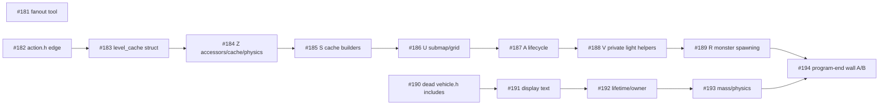

# Hub-header split program

Resolution of wayfinder ticket #145 (map #134, macOS dev-loop speed and stability). Decided with the user on 2026-10-13 by structured grilling (four rounds). Facts come from three read-only scouts run the same day on branch `feature/improvements`; their method and caveats are summarised under "Evidence".

## Destination

A hub-header edit reaches a usable binary in <= 10 min (map #134 target 2). `map.h` is the only hub over target today (~10.4 min, 565 edges, `plans/dev-loop-speed-and-stability.md:35`); `vehicle.h` is inside it (~5.9 min, 232 edges). The program shrinks the rebuild set of both by moving rarely-needed, frequently-edited declarations out of the class bodies and cutting propagation edges.

## Decisions

| #  | Decision        | Detail                                                                                                                                                                                                                                                                                                                                  |
| -- | --------------- | --------------------------------------------------------------------------------------------------------------------------------------------------------------------------------------------------------------------------------------------------------------------------------------------------------------------------------------- |
| 1  | Scope           | Structural class decomposition of `map.h` and `vehicle.h` now, both tracks in parallel.                                                                                                                                                                                                                                                 |
| 2  | Fence           | `map.h` fence lifted: `feature/fast-track-to-co-op` is an ancestor of `feature/improvements` (`git log feature/improvements..feature/fast-track-to-co-op` is empty). `game.h` splits wait for the turn-plan chain #172/#173, which deletes members from `game.h`. No `game.h` ticket exists yet; every ticket forbids editing `game.h`. |
| 3  | Waiver          | Named list with sunset, written into `AGENTS.md` (line "SHOULD NOT modify existing headers with >10 usages"): `src/map.h` and `src/vehicle.h`, until their program tickets close. Adding a header needs a plan amendment and an AGENTS.md edit.                                                                                         |
| 4  | First tickets   | Include-edge cuts before structural work (#182 `action.h:11`, #190 dead `vehicle.h` includes).                                                                                                                                                                                                                                          |
| 5  | Mechanism       | Free functions in a new header taking `map&`/`vehicle&`, over **public accessors**; widen accessors case by case; no `friend`, no forwarding members, no shims (clean cutover). Clusters that cannot be separated that way stay and are recorded as inseparable.                                                                        |
| 6  | Selection       | Rank clusters by **churn x spared consumers** (non-sweep commits since 2026-01-01, multiplied by fan-out minus the cluster's consumer TUs), excluding the seven Oct 1-3 facade commits (map #23, closed).                                                                                                                               |
| 7  | Done per PR     | Rebuild-set count drop with a target stated in the ticket (1.5x the cluster's measured consumer count, rounded up); one idle-box wall A/B at program end (#194).                                                                                                                                                                        |
| 8  | Lane            | Interactive macOS sessions. Factory only for mechanical call-site migration after a new header exists. Reason: the metric lives on the macOS ninja build and the factory lane is Windows/MSVC.                                                                                                                                          |
| 9  | Guard           | On-demand `deno task fanout <header>` plus an advisory (never blocking) pre-commit message (#181). No CI gate: map #134 keeps Windows/Linux CI byte-identical.                                                                                                                                                                          |
| 10 | Upstream merges | Accept the conflict cost: merge upstream into `feature/improvements` before each extraction ticket and land the split in the same window. Merge commits are 26% (`map.h`) and 29% (`vehicle.h`) of non-sweep churn since 2026-01-01.                                                                                                    |

## Ticket graph

Within a header the tickets are serial (each edits the same class). The map and vehicle tracks run in parallel.

`A` runs after `Z`, `S` and `U` on purpose: the churn scout found them to be one cache-lifecycle super-cluster (27 distinct commits touch A/Z/S/U, 6 touch all four pairwise), so extracting `A` alone would leave most of its churn recompiling the same files. The order may be changed if a design step finds a cluster inseparable.

## Ranking (churn x spared, facade commits excluded)

Fan-out baseline: `map.h` 397 `.cpp` (339 direct includers); `vehicle.h` 220 TUs (216 direct). Consumers are distinct TUs calling a member of the cluster (lower bounds).

| header  | cluster                          | churn | consumers | spared | churn x spared | ticket               |
| ------- | -------------------------------- | ----- | --------- | ------ | -------------- | -------------------- |
| map     | Z misc accessors/cache/physics   | 14    | 37        | 360    | 5,040          | #184                 |
| map     | A lifecycle/load/shift/dimension | 13    | 53        | 344    | 4,472          | #187                 |
| map     | S cache builders                 | 8     | 6         | 391    | 3,128          | #185                 |
| map     | U submap access/grid cache       | 7     | 11        | 386    | 2,702          | #186                 |
| map     | V light sources (private)        | 6     | 0         | 397    | 2,382          | #188                 |
| map     | R monster spawning               | 6     | 9         | 388    | 2,328          | #189                 |
| map     | Q bounds/bubble/geometry         | 6     | 73        | 324    | 1,944          | none yet (next)      |
| map     | D terrain+furniture data access  | 6     | 145       | 252    | 1,512          | none: high consumers |
| map     | C vehicle subsystem              | 6     | 149       | 248    | 1,488          | none: high consumers |
| vehicle | display text                     | 6     | 14        | 206    | 1,236          | #191                 |
| vehicle | lifetime/serialize/owner/theft   | 4     | 34        | 186    | 744            | #192                 |
| vehicle | mass/physics/performance         | 4     | 47        | 173    | 692            | #193                 |
| vehicle | damage/destruction               | 3     | 23        | 197    | 591            | none yet (next)      |
| vehicle | coords/positioning               | 4     | 77        | 143    | 572            | none: high consumers |

Outside the class: `struct level_cache` (`map.h:337-511`, held as `std::array<std::unique_ptr<level_cache>, OVERMAP_LAYERS>` at `map.h:2398`) has 12 first-parent non-merge commits since 2026-01-01 (9 excluding the facade; `git log -L337,511:src/map.h`) and is #183. The sound-cache structs (`map.h:513`, `:695`) are decided inside #183.

The cut line (extract in descending order until the curve flattens) is drawn after R on `map` and after the mass/physics cluster on `vehicle`; `Q` and vehicle damage/destruction are the first candidates if the program is extended.

## Evidence and caveats

- Scouts: cluster tables, per-cluster consumers and includer distributions (`map.h`: 339 direct `.cpp` includers, 52 use no cluster, 60 one, 50 two, 177 three or more; `vehicle.h`: 216 direct, 51/40/37/88). No thin header serves every includer; the value comes from _churn_ being concentrated in clusters few TUs use.
- Churn: `git log --first-parent --since=2026-01-01`; `map.h` 44 commits, `vehicle.h` 33; two whitespace-only sweeps (`4f889be69e`, `d1328857e2`) excluded from both. Excluding the seven facade commits (`cbe5ffd9fe`, `0702f9b330`, `0dba51deec`, `9ce8a954fb`, `1beb799986`, `2d958b0d6a`, `d93eb3807c`) leaves 35 for `map.h` (9 merge-absorbed, 26%); `vehicle.h` contains none of them. Only A (17 to 13), S (10 to 8) and O (4 to 3) lose commits.
- Consumer counts and the receiver-gated attribution are **lower bounds** (macros, templates, function pointers and Lua bindings are missed), so the savings above are upper bounds. The 36 and 29 "no vehicle token" counts overstate removable includes: `vehicle.h` re-exports `item.h`, `item_stack.h` and `coordinates.h`; #153's conservative rule found 0 removable `vehicle.h` includes.
- Correction recorded during the grilling: cutting `vpart_range.h:11` frees only about 2 TUs (216 of `vehicle.h`'s 220 closure already include it directly; `vpart_range.h`'s own reach, ~90 TUs, is a different number). The vehicle edge-cut ticket is therefore #190, "remove dead direct includes", not that edge.
- The `action.h:11` edge cut (#182) is the largest cheap win: 152 of 397 transitive `.cpp` lose `map.h` per the include graph, none calling a `map` member; whether they all compile needs the build.

## Tickets

| #         | Title                                                                |
| --------- | -------------------------------------------------------------------- |
| #181      | `deno task fanout` + advisory pre-commit report                      |
| #182      | Cut the map.h include from action.h                                  |
| #183      | Move `struct level_cache` out of map.h                               |
| #184-#189 | map.h clusters Z, S, U, A, V (private helpers to `lightmap.cpp`), R  |
| #190      | Remove dead direct includes of vehicle.h                             |
| #191-#193 | vehicle.h clusters: display text, lifetime/owner/theft, mass/physics |
| #194      | Program-end idle-box wall A/B                                        |

Targets per ticket are in the ticket bodies. Coordination: #193 touches vehicle physics, which the `spec:vehicle-system` factory tickets (#166-#169) also edit; it waits for them. Game.h splits are intentionally not ticketed until #173 closes.
